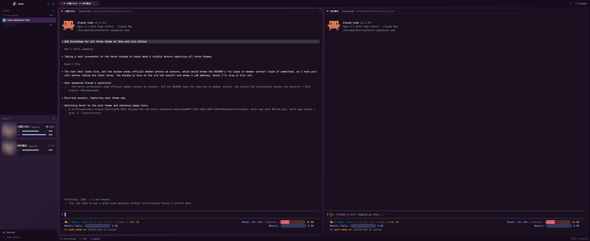
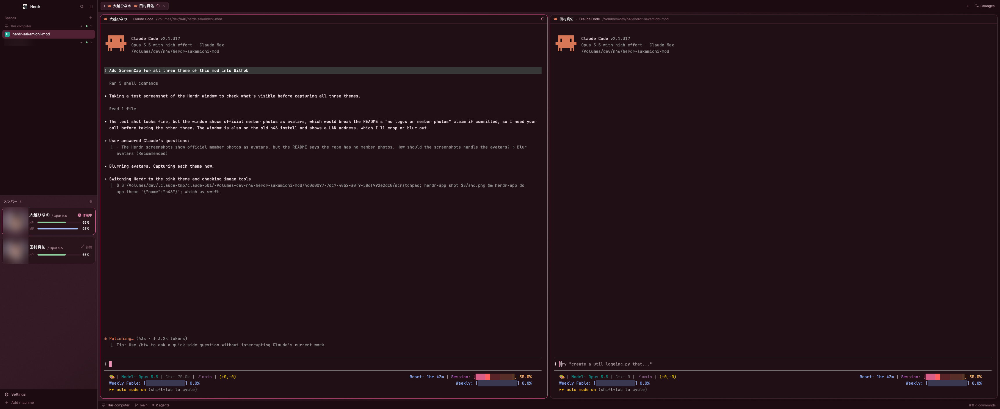
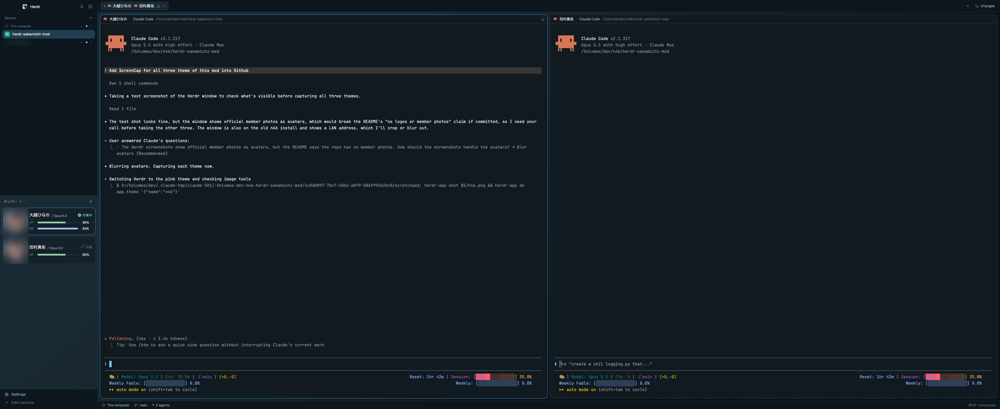

# herdr-sakamichi-mod

[English](../README.md) · [繁體中文](README.zh-TW.md) · **日本語**

[Herdr](https://herdr.dev) のウィンドウにいるコーディングエージェントを、坂道グループのメンバーに変えます。エージェント一人ひとりが乃木坂46・櫻坂46・日向坂46 の現役メンバーになり、カード・タブ・ペインに彼女の名前、アバターに彼女の写真、そして残りの作業量を示す 2 本のゲージが表示されます。

この文書は英語の [README.md](../README.md) の翻訳です。内容は英語版が正です。ファンによる非公式の作品で、乃木坂46・櫻坂46・日向坂46、運営会社、Herdr とは関係ありません。リポジトリにはロゴやメンバーの写真は含まれていません。

## スクリーンショット

アバターはぼかしています。リポジトリにメンバーの写真は含まれていません。

| 乃木坂46（`n46`） | 櫻坂46（`s46`） | 日向坂46（`h46`） |
| --- | --- | --- |
|  |  |  |

## 機能

- **メンバー一覧。** エージェントごとにカード 1 枚：アバター、メンバー名、モデル（`岡本姫奈 / Opus 5.5`）、動く状態表示、HP／MP ゲージ。
- **タブとペインのヘッダー。** 各タブに番号と、そこで働くメンバー（`1 [アイコン] 川﨑桜 [アイコン] 田村真佑`）。名前を変えたタブは先にタブ名。各エージェントのペインのヘッダーは彼女の名前から始まります（`愛宕心響 · Claude Code`）。
- **3 つのグループ。** 乃木坂46（パープル）・櫻坂46（ピンク）・日向坂46（空色）を切り替えると、テーマとメンバーが一緒に変わります。
- **アバター。** 好きな画像を入れるか、公式写真をワンクリックで取り込めます。macOS では顔を中心に切り抜きます。
- **HP と MP。** HP は Claude Code の 5 時間枠、MP はセッションのコンテキスト。

表示は日本語が標準で、設定ひとつで英語にできます。

## 動作環境

- Herdr デスクトップアプリ（`herdr-app` が `PATH` にあること）。Herdr 0.1.12・macOS 26.7 で動作確認済み（2026-11-03）。
- 顔を中心にしたアバターの切り抜きには macOS が必要です。Linux では `.png`・`.jpg` のアバターを切り抜かずに使います。Windows ではアバターを設定できません。
- Node.js（HP／MP ゲージにだけ必要）。

## インストール

いちばん簡単なのは、Herdr の中でエージェントに頼む方法です。

> Read ~/.config/herdr-app/AGENTS.md, then add the layout from <https://github.com/payt0nc/herdr-sakamichi-mod> (folder `n46`). Read n46/RECIPE.md first.

手動の場合：

1. リポジトリを clone します。

   ```sh
   git clone https://github.com/payt0nc/herdr-sakamichi-mod.git && cd herdr-sakamichi-mod
   ```

2. レイアウト、3 つのテーマ、3 つの mod を Herdr にコピーします。mod は実フォルダとしてコピーしてください。シンボリックリンクの mod はアイコンを読み込めません。

   ```sh
   H=~/.config/herdr-app
   cp n46/layouts/46.json n46/layouts/46.svg "$H/layouts/"
   cp n46/themes/n46.json n46/themes/s46.json n46/themes/h46.json "$H/themes/"
   cp -R n46/mods/46-agents n46/mods/46-pane n46/mods/46-tabs "$H/mods/"
   ```

3. mod をチェックします。それぞれ `check passed` と表示されます。

   ```sh
   for m in 46-agents 46-pane 46-tabs; do herdr-app check "$H/mods/$m"; done
   ```

4. レイアウトを切り替えます。

   ```sh
   herdr-app do layout.switch '{"name":"46"}'
   ```

同じ名前のファイルがある場合は、上書きせずに新しい方の名前を変えてください。`ctrl-shift-l` でいつでも自分のレイアウトに戻れます。

### HP と MP を有効にする

ゲージは Claude Code のステータスラインを読みます。`~/.claude/settings.json` に次を追加します。

```json
"statusLine": {
  "type": "command",
  "command": "node ~/.config/herdr-app/mods/46-agents/statusline.mjs",
  "refreshInterval": 10
}
```

すでにステータスラインがある場合は、そのコマンドをスクリプトの後ろに付けます（例：`node ~/.config/herdr-app/mods/46-agents/statusline.mjs ccstatusline`）。今までどおり表示されます。

## 使い方

### メンバーと状態

エージェントには、表示中のグループの空いているメンバーがランダムに割り当てられ、再起動しても変わりません。グループ全員（乃木坂46 33 人、櫻坂46 30 人、日向坂46 26 人）が埋まるまで、同じメンバーが重なることはありません。Herdr でピン留めしたエージェントが先頭に来ます。カードをクリックするとそのエージェントに移動します。

| 状態（`ja` / `en`） | アイコン | カード |
| --- | --- | --- |
| 作業中 / Working | 1.4 秒で 1 回転するレコード | アバター枠と状態表示がグループカラー |
| 要対応 / Needs you | 0.7 秒ごとに跳ねる吹き出し | 枠・アバター枠・状態表示が琥珀色。フォーカス枠より優先 |
| 完了 / Done | 1.6 秒ごとに点滅するダブルチェック | ミント色の状態表示 |
| 待機 / Idle | 2.4 秒ごとに浮かんでフェードする 💤 | グレーの状態表示 |

アニメーションは Herdr のネイティブ機能で動き、カードが画面外にあるときは止まります。

### HP と MP

- **HP** は Claude Code の 5 時間枠の残り。尽きるとエージェントは止まります。
- **MP** はセッションの残りコンテキスト。会話の圧縮（compaction）で回復します。

20% を切るとゲージは琥珀色になります。ゲージが表示されるのは、このマシンの Claude Code エージェントで、ステータスラインを設定した後だけです。

### 設定

メンバー一覧の見出しの **⚙** で設定を開きます。エージェントのカードを右クリックすると、そのメンバーを選んだ状態で開きます。

| したいこと | 操作 |
| --- | --- |
| グループを切り替える | **乃木坂46**・**櫻坂46**・**日向坂46** を押します。Herdr のテーマメニューで `n46`・`s46`・`h46` を選んでも同じです。それ以外のテーマでは最後に選んだグループのまま。動作中のエージェントはメンバーを保ち、新しいエージェントには新しいグループのメンバーが割り当てられます |
| アバターを設定する | 画像をメンバーにドラッグするか、メンバーを選んでファイルのパス（`~/Pictures/me.png`）か画像の URL を入力します |
| 公式写真を取り込む | **公式サイトの写真を取り込む** を押します。表示中のグループでアバター未設定のメンバーに写真を入れ、以前取り込んだ公式写真を更新します。自分で選んだ画像は置き換えません |
| アバターを消す | **リセット** で一人分、**すべてリセット**（もう一度押して確定）で表示中のグループ全員分 |

アバターは 144×144 で保存されます。まだエージェントに割り当てられている他グループのメンバーは、グループ名付き（`乃木坂46 · 5期生`）で一覧の先頭に表示されます。

### 設定ファイル

`~/.config/herdr-app/mods/46-agents/members.json`：

| キー | 効果 |
| --- | --- |
| `"lang": "en"` | 名前、ラベル、状態表示を英語に（標準は `"ja"`） |
| `"pins": { "Claude Code": "井上和" }` | `Claude Code` という名前のタブに、常にそのメンバーを割り当てる（日本語名・英語名どちらでも可） |
| `"members"` | グループごとのメンバー一覧（`"n46"`・`"s46"`・`"h46"`）。卒業・加入に合わせて編集します |

mod を更新すると `members.json` は上書きされるので、先に `pins` を控えておいてください。

## `n46-*` からのアップグレード

2026 年 11 月まで、レイアウトは `n46`、mod は `n46-agents`・`n46-pane`・`n46-tabs` という名前でした。新しいファイルをインストールしたら：

1. `46` レイアウトに切り替えます。`46-agents` は初回起動時に、旧名からメンバーの割り当て・グループ・アバターをコピーします。
2. `~/.claude/settings.json` の `statusLine` のコマンドを `mods/46-agents/statusline.mjs` に変更します。
3. 「アンインストール」の 2 行目の `rm` で古いファイルを削除します。

## アンインストール

```sh
H=~/.config/herdr-app
herdr-app do layout.switch '{"name":"main"}'
rm -rf "$H/mods/46-agents" "$H/mods/46-pane" "$H/mods/46-tabs" "$H/data/46-agents"
rm -rf "$H/mods/n46-agents" "$H/mods/n46-pane" "$H/mods/n46-tabs" "$H/data/n46-agents" "$H/layouts/n46.json" "$H/layouts/n46.svg" # names before Nov 2026
rm -f "$H/layouts/46.json" "$H/layouts/46.svg" "$H/themes/n46.json" "$H/themes/s46.json" "$H/themes/h46.json"
```

`statusLine` を追加した場合は、`~/.claude/settings.json` からも削除してください。

## あなたのマシンで実行されるもの

- メンバー一覧、タブバー、ペインのヘッダーは、`members.json` と `~/.config/herdr-app/data/46-agents/` 以下のファイルを読むだけで、プログラムは実行しません。
- アバターを設定するときは `cp`（URL の場合は `curl`）、`sips`、顔検出用に mod 同梱の `face.jxa` を `osascript` で、そして `mv` を実行します。
- ネットワークを使うのは、入力したアバターの URL と **公式サイトの写真を取り込む** のときだけです。後者は表示中のグループの公式サイト（`www.nogizaka46.com`、`sakurazaka46.com`、または `www.hinatazaka46.com` と `cdn.hinatazaka46.com`）に接続します。
- `statusline.mjs` はターミナルごとにモデル名と 2 つのパーセンテージを保存します。認証情報は読みません。
- キー設定は変更しません。

アバターには、使用する権利のある画像を使ってください。

## ライセンス

コードとドキュメントは [MIT License](../LICENSE) で提供します。メンバー名はエージェントの表示にのみ使います。追加・取り込みしたアバター画像の権利は各権利者に帰属し、このライセンスの対象外です。

## コントリビュート

コミットの書き方とバージョン規則は [CONTRIBUTING.md](../CONTRIBUTING.md)、コーディングエージェントでこのリポジトリを扱う方法は [AGENT.md](../AGENT.md) を参照してください。
