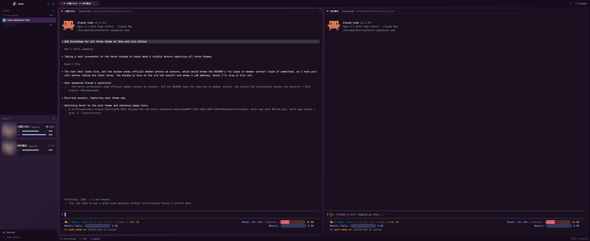
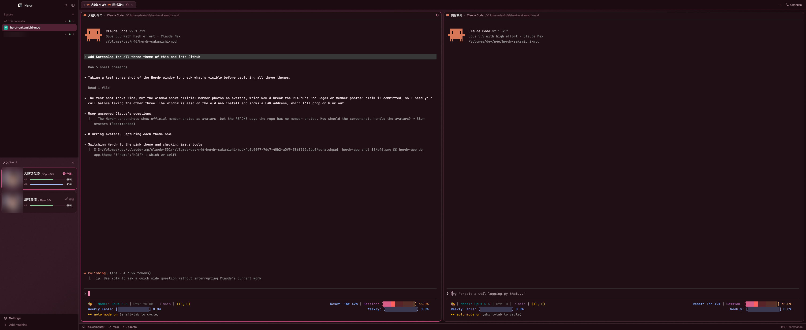
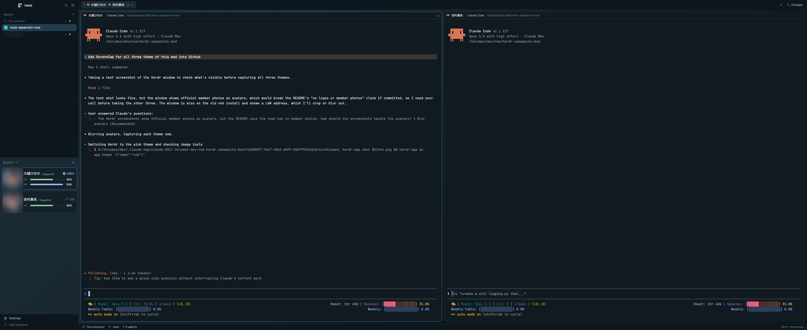

# herdr-sakamichi-mod

[English](../README.md) · **繁體中文** · [日本語](README.ja-JP.md)

把 [Herdr](https://herdr.dev) 視窗裡的 coding agent 變成坂道偶像。每個 agent 都會成為乃木坂46、櫻坂46 或日向坂46 的一位現役成員：卡片、分頁和 pane 上顯示她的名字，頭像是她的照片，再加上兩條顯示剩餘工作量的量表。

本文是英文 [README.md](../README.md) 的翻譯，內容以英文版為準。這是粉絲自製作品，與乃木坂46、櫻坂46、日向坂46、其經紀公司及 Herdr 都沒有關係。repo 裡沒有任何 logo 或成員照片。

## 截圖

截圖中的頭像已模糊處理；本 repo 不附成員照片。

| 乃木坂46（`n46`） | 櫻坂46（`s46`） | 日向坂46（`h46`） |
| --- | --- | --- |
|  |  |  |

## 功能

- **成員清單。** 每個 agent 一張卡片：頭像、成員名、模型（`岡本姫奈 / Opus 5.5`）、會動的狀態，以及 HP／MP 量表。
- **分頁與 pane 標題列。** 每個分頁顯示編號和在裡面工作的成員（`1 [圖示] 川﨑桜 [圖示] 田村真佑`）；改過名的分頁會先顯示分頁名。每個 agent 的 pane 標題列以她的名字開頭（`愛宕心響 · Claude Code`）。
- **三個團體。** 在乃木坂46（紫）、櫻坂46（粉紅）、日向坂46（天藍）之間切換，視窗主題和成員一起換。
- **頭像。** 放任何圖片進來，或一鍵匯入官方照片。在 macOS 上每張圖都會以臉為中心裁切。
- **HP 與 MP。** HP 是 Claude Code 5 小時額度，MP 是 session 的 context。

名稱預設是日文，改一個設定就能換成英文。

## 需求

- Herdr 桌面 app，且 `herdr-app` 在 `PATH` 上。測試環境：已實測（2026-11-03，Herdr 0.1.12、macOS 26.7）。
- 以臉為中心裁切頭像需要 macOS。Linux 上 `.png`、`.jpg` 頭像不裁切直接使用；Windows 無法設定頭像。
- Node.js，只有 HP／MP 量表需要。

## 安裝

最快的方式是在 Herdr 裡請你的 agent 執行：

> Read ~/.config/herdr-app/AGENTS.md, then add the layout from https://github.com/payt0nc/herdr-sakamichi-mod (folder `n46`). Read n46/RECIPE.md first.

手動安裝：

1. Clone repo：

   ```sh
   git clone https://github.com/payt0nc/herdr-sakamichi-mod.git && cd herdr-sakamichi-mod
   ```

2. 把 layout、三個主題和三個 mod 複製進 Herdr。mod 要複製成真正的資料夾，用 symlink 的 mod 載入不了圖示。

   ```sh
   H=~/.config/herdr-app
   cp n46/layouts/46.json n46/layouts/46.svg "$H/layouts/"
   cp n46/themes/n46.json n46/themes/s46.json n46/themes/h46.json "$H/themes/"
   cp -R n46/mods/46-agents n46/mods/46-pane n46/mods/46-tabs "$H/mods/"
   ```

3. 檢查 mod，每個都會印出 `check passed`：

   ```sh
   for m in 46-agents 46-pane 46-tabs; do herdr-app check "$H/mods/$m"; done
   ```

4. 切換到這個 layout：

   ```sh
   herdr-app do layout.switch '{"name":"46"}'
   ```

如果已經有同名檔案，把新的改名，不要覆蓋你自己的。`ctrl-shift-l` 隨時可以切回你自己的 layout。

### 開啟 HP 與 MP

量表讀的是 Claude Code 的 status line。在 `~/.claude/settings.json` 加上：

```json
"statusLine": {
  "type": "command",
  "command": "node ~/.config/herdr-app/mods/46-agents/statusline.mjs",
  "refreshInterval": 10
}
```

已經有 status line 了？把它的指令接在腳本後面，例如 `node ~/.config/herdr-app/mods/46-agents/statusline.mjs ccstatusline`，它會照常顯示。

## 使用

### 成員與狀態

每個 agent 會隨機分到顯示中團體裡一位還沒被分走的成員，重新啟動後也不變；整個團體都分完後（乃木坂46 33 位、櫻坂46 30 位、日向坂46 26 位）才會有兩個 agent 同一位成員。在 Herdr 釘選的 agent 排在最前面。點卡片會跳到那個 agent。

| 狀態（`ja` / `en`） | 圖示 | 卡片 |
| --- | --- | --- |
| 作業中 / Working（工作中） | 黑膠唱片，每 1.4 秒轉一圈 | 頭像框和狀態字用團體色 |
| 要対応 / Needs you（需要你處理） | 對話框圖示，每 0.7 秒上下跳動 | 外框、頭像框和狀態字變琥珀色，蓋過聚焦外框 |
| 完了 / Done（完成） | 雙勾，每 1.6 秒閃一次 | 薄荷綠狀態字 |
| 待機 / Idle | 💤 每 2.4 秒往上飄並淡出淡入 | 灰色狀態字 |

動畫由 Herdr 原生處理，卡片不在畫面上時會停止。

### HP 與 MP

- **HP** 是 Claude Code 5 小時額度的剩餘量，用完 agent 就停了。
- **MP** 是這個 session 剩餘的 context，壓縮對話可以恢復。

低於 20% 時量表會變琥珀色。只有這台電腦上的 Claude Code agent，在設定好 status line 之後才會顯示量表。

### 設定

用成員清單標題列的 **⚙** 打開設定。在 agent 卡片上按右鍵，會直接選好那張卡的成員。

| 想要 | 做法 |
| --- | --- |
| 切換團體 | 點 **乃木坂46**、**櫻坂46** 或 **日向坂46**。從 Herdr 主題選單選 `n46`、`s46` 或 `h46` 效果相同；選其他主題時維持上次選的團體。執行中的 agent 保留已分到的成員，新的 agent 分到新團體的成員 |
| 設定頭像 | 把圖片拖到成員上，或選好成員後輸入檔案路徑（`~/Pictures/me.png`）或圖片網址 |
| 匯入官方照片 | 按 **公式サイトの写真を取り込む**。替顯示中團體裡還沒有頭像的成員補上照片，並更新先前匯入的官方照片，但不會覆蓋你自己選的圖 |
| 移除頭像 | **リセット** 移除一位；**すべてリセット** 按第二次確認後，移除顯示中團體的全部頭像 |

頭像存成 144×144。仍代表某個 agent 的其他團體成員會排在清單最前面，並標上團體名（`乃木坂46 · 5期生`）。

### 設定檔

`~/.config/herdr-app/mods/46-agents/members.json`：

| 鍵 | 效果 |
| --- | --- |
| `"lang": "en"` | 名稱、標籤和狀態字改成英文（預設 `"ja"`） |
| `"pins": { "Claude Code": "井上和" }` | 名為 `Claude Code` 的分頁固定分到這位成員，日文或英文名都可以 |
| `"members"` | 各團體的成員名單（`"n46"`、`"s46"`、`"h46"`），有成員畢業或加入時編輯 |

更新 mod 會覆蓋 `members.json`，更新前先把你的 `pins` 存下來。

## 從 `n46-*` 名稱升級

2026 年 11 月以前，layout 叫 `n46`，mod 叫 `n46-agents`、`n46-pane`、`n46-tabs`。安裝新檔案後：

1. 切換到 `46` layout。`46-agents` 第一次啟動時，會從舊名稱複製你的成員分配、團體和頭像。
2. 把 `~/.claude/settings.json` 裡 `statusLine` 的指令改成 `mods/46-agents/statusline.mjs`。
3. 用「移除」一節的第二行 `rm` 刪掉舊檔案。

## 移除

```sh
H=~/.config/herdr-app
herdr-app do layout.switch '{"name":"main"}'
rm -rf "$H/mods/46-agents" "$H/mods/46-pane" "$H/mods/46-tabs" "$H/data/46-agents"
rm -rf "$H/mods/n46-agents" "$H/mods/n46-pane" "$H/mods/n46-tabs" "$H/data/n46-agents" "$H/layouts/n46.json" "$H/layouts/n46.svg" # names before Nov 2026
rm -f "$H/layouts/46.json" "$H/layouts/46.svg" "$H/themes/n46.json" "$H/themes/s46.json" "$H/themes/h46.json"
```

如果加過 `statusLine`，也從 `~/.claude/settings.json` 移除。

## 會在你的電腦上執行什麼

- 成員清單、分頁列和 pane 標題列只讀 `members.json` 與 `~/.config/herdr-app/data/46-agents/` 底下的檔案，不執行任何程式。
- 設定頭像時會執行 `cp`（輸入網址時改用 `curl`）、`sips`、用 `osascript` 跑 mod 內附的 `face.jxa` 做臉部偵測，以及 `mv`。
- 只有你輸入的頭像網址和 **公式サイトの写真を取り込む** 會用到網路；後者連線到顯示中團體的官網：`www.nogizaka46.com`、`sakurazaka46.com`，或 `www.hinatazaka46.com` 與 `cdn.hinatazaka46.com`。
- `statusline.mjs` 依終端機存下模型名稱和兩個百分比，不讀任何憑證。
- 不會改動你的按鍵設定。

請使用你有權使用的頭像圖片。

## 授權

程式碼與文件以 [MIT License](../LICENSE) 授權。成員名稱只用來標示 agent；你加入或匯入的頭像圖片權利屬於原權利人，不在這份授權範圍內。

## 參與貢獻

commit 格式與版本規則見 [CONTRIBUTING.md](../CONTRIBUTING.md)；用 coding agent 修改這個 repo 的說明見 [AGENT.md](../AGENT.md)。
